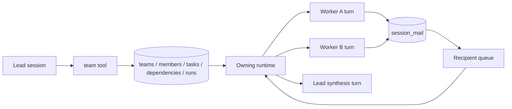

# Agent Teams

This implementation adds a local team orchestration layer to the Go OpenCode application. It targets the core Claude Code Agent Teams workflow: a lead creates named teammates, teammates execute independent turns, ready tasks are claimed from a shared list, and results automatically return to the lead. It is not a claim of identical behavior or complete feature parity with Claude Code.

## Start in the TUI

Run OpenCode normally with a configured provider, then ask:

> Create a team named review. Spawn a reviewer to inspect the API and a tester to inspect tests. Give them separate file ownership. Have them exchange findings, create dependent follow-up tasks, and summarize their results.

The `team` tool is available to the coder and teammates. Team creation asks for permission. Workers use the existing permission system for file writes, shell commands, network tools, and messaging. Concurrent permission requests are queued in the TUI and labeled with their session. No write permissions are automatically inherited merely because another teammate received approval.

Use **Ctrl+K → Agent Teams** for the dashboard:

- Left/right: select a team; Tab: select members or tasks; up/down: select a row.
- Enter on a member: open its conversation. Text sent there is queued as a human instruction, including when another process hosts the team.
- `p` / `r` / `s`: pause, resume, or stop the selected member.
- `a` / `x` / `y`: approve, cancel, or retry the selected task.
- `R`: resume/start the team runtime in this process. This is also the explicit recovery entry point after restarting OpenCode.
- Escape: return to chat.

Teammate conversations use separate persistent histories. Shell environment and working-directory state are isolated by session. Files are still shared: assign different files or modules to workers. This implementation does not automatically create git worktrees or merge their changes.

## CLI workflow

Metadata commands do not need model credentials. Run commands from the project directory; for a custom DB location, pass `--data-dir /absolute/path/to/.opencode` to `teams` and `messages`.

```bash
# Creates a persistent lead session unless --lead EXISTING_SESSION is given
opencode teams create review
opencode teams list

# Replace TEAM with the ID or name returned by create
opencode teams spawn TEAM reviewer --prompt "Review the API; report findings without editing"
opencode teams spawn TEAM tester --prompt "Review tests and report missing cases" --max-turns 30

# Optional --model uses an OpenCode supported model ID, e.g. gpt-4.1
opencode teams status TEAM
opencode teams watch TEAM

# Host the team. Uses current project/provider configuration.
# Permission-requiring tools are denied by default in this headless mode.
opencode teams run TEAM

# Explicitly allow permission-requiring tools for this runtime instead:
opencode teams run TEAM --allow-tools
```

The default headless policy still permits tools the existing application classifies as read-only; it is not a filesystem/network sandbox. `--allow-tools` is an explicit runtime-wide approval, including newly spawned teammates. For per-request approval use the TUI. One-shot `opencode -p` cannot host teams and the team tool returns an explanation instead of launching workers that would immediately be canceled when the command exits.

From another terminal:

```bash
opencode teams tell TEAM reviewer --body "Focus on authentication boundary cases"
opencode teams task TEAM --title "Fix reviewed issue" --prompt "Implement the agreed fix" \
  --assignee WORKER_SESSION --depends-on REVIEW_TASK_ID --require-approval
opencode teams approve TEAM TASK_ID
opencode teams assign TEAM TASK_ID WORKER_SESSION
opencode teams cancel TEAM TASK_ID
opencode teams pause TEAM WORKER_SESSION
opencode teams resume TEAM WORKER_SESSION
opencode teams retry TEAM TASK_ID
opencode teams stop TEAM
```

`pause`, `resume`, and `stop` without a target control the team. To resume a paused/failed teammate use its session ID; to retry failed work use its task ID. Resuming a member resets its automatic-turn budget. Resuming a team alone does not silently retry failed tasks or resume individually paused members. Stopping a team cancels active turns, retains history, and causes `teams run` to exit. Ctrl+C shuts down the hosting runtime and releases ownership. CLI control is a trusted local user action; model tools additionally check team membership and lead authority.

## Tool contract

`team` actions:

| Action | Inputs and behavior |
| --- | --- |
| `create` | `name`; current session becomes lead, runtime starts |
| `spawn` | `name`, `prompt`, optional `model`, `max_turns`; lead only; creates worker plus initial task |
| `status` | Returns team, members, shared tasks with dependencies, and up to 100 latest execution records |
| `task` | `title`, `prompt`, optional worker `assignee`, `dependencies`, `approval` |
| `message` | Teammate name/session in `target`, text in `prompt`; `all` fans out to other members |
| `pause`, `resume`, `stop` | Optional member session in `target`; empty target controls team; lead only |
| `approve`, `retry`, `cancel` | Task ID in `target`; lead only |
| `assign` | Non-running task in `target`, worker session in `assignee`; lead only |

`team` can be omitted after joining a team. Messages from the existing `session_message` tool and messaging CLI also wake registered teammates. Messages already present when a member joins are excluded from automatic execution. Human instructions use a dedicated operator mailbox identity and pass through the same serialized execution queue.

An approval-gated task cannot start before approval, and dependencies must all complete successfully. For a plan-review-implement workflow, first run a planning task, then create an approval-gated implementation task depending on it. This is an execution gate on tasks, not a separate provider-level plan-only tool mode.

## Execution and persistence



A team has one hosting process at a time. SQLite stores the owner UUID, a monotonically increasing fencing epoch, and a 15-second lease. The runtime renews every 3 seconds. Claims acquire the database write lock before checking readiness and reserve both task and member in one transaction. Completion verifies the owner, epoch, and lease before writing results. A second owner cannot start while the lease is valid.

The runtime polls every 250 ms and runs at most eight simultaneous turns per team. A team supports up to 32 members including the lead. Each member starts with a budget of 30 automatic turns (configurable between 1 and 1,000 for workers). One turn may contain multiple model/tool exchanges and has a 30-minute deadline. Budget exhaustion or execution failure pauses the member. These are turn/time limits, not a token or monetary budget.

Incoming messages are processed automatically **after the current turn finishes**; token streams and running tool calls are not forcibly injected into. New mail has priority over a new task. Completed or failed worker turns persist their result and enqueue a lead notification in the same transaction. The lead then runs when idle. Finishing a lead turn does not generate another completion notification to itself. The lead's model decides whether more coordination is needed; the runtime does not promise the quality of that reasoning.

Each process also holds a per-session execution lock shared across model-specific agents. Cancellation retains that lock until execution exits. User chat input to registered team members goes through the mailbox instead of opening a competing local turn. Pause a team member before compacting its history.

Conversation history, mailbox delivery, and task execution are separate concepts. `team_runs.mail_id` uniquely records automatic delivery independently of mailbox `read_at`; manually reading mail does not suppress automatic execution. Runtime completion marks the mailbox message read. Polling a status view does not execute any work.

## Failures and recovery

On normal shutdown, turns are canceled and their completion is drained before the lease is released. On an expired lease, a new runtime marks interrupted runs/tasks failed and pauses affected members. It never blindly replays an interrupted write or shell command. Inspect the working tree and recorded result, then resume the member and explicitly retry/reassign the task.

If a completion cannot be committed, the runtime logs the failure and stops so another explicit start can recover it. If the database is unavailable or the lease is lost, the runtime cancels its workers. Fencing protects database results; it cannot undo external tool effects or guarantee that a suspended old OS process never resumes a side effect after lease expiry. This is not exactly-once execution of shell commands or network requests.

Task dependencies point only to already existing tasks in the same team. They are immutable after creation, preventing cycles by construction. A failed/canceled prerequisite keeps dependent tasks blocked until the prerequisite is explicitly retried and completed. Tasks cannot be reassigned while running or after completion. Runs are retained for diagnosis, and status returns only the latest 100. Automatic pruning and team deletion are not implemented.

## Scope relative to Claude Code

Implemented and covered by tests: named lead/worker lifecycle, separate conversation contexts, model selection, automatic queued message execution, worker-to-lead completion/failure notifications, shared task claiming, dependency gates, task approval/reassignment/retry, direct human instructions, team dashboard, process ownership, cancellation and crash recovery.

Remaining differences: no tmux/iTerm split-pane launcher, remote/distributed workers, per-worker git worktree setup, Claude-specific hooks, or dedicated plan-only tool mode. The current turn completes before inbound messages are processed. Files share one project workspace. Live paid-model reasoning quality and a full manual terminal UX audit are not established by automated tests. These differences must not be represented as complete Claude Code feature parity.

## Verification

```bash
go test ./...
go test -race ./...
go build -o /tmp/opencode-teams .
python3 scripts/test-agent-teams.py /tmp/opencode-teams
```

The end-to-end script starts a localhost OpenAI-compatible deterministic provider and a real CLI team runtime. Two teammates use independent histories (one explicitly selects a model), execute the real file-writing tool, honor dependency and approval gates, receive a new message automatically, notify the lead, and stop gracefully. It makes no paid model calls. Unit tests cover independent SQLite connections racing to claim work, lease theft/fencing, interrupted-run recovery, budgets, authorization, queued permission cancellation, concurrent broker shutdown, session shell isolation, and dashboard navigation.
