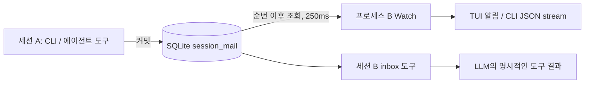

# Cross-session messaging 설계 및 구현

후속 구현: [Agent Teams](agent-teams.md)는 등록된 팀원에 자동 실행·작업 조율을 추가한다. 아래의 자동 실행 미지원 설명은 일반 세션의 기본 메시징 계층에 해당한다.

기준 소스: `73ee493`의 Go OpenCode. 이 문서는 현재 체크아웃을 분석한 결과이며 다른 OpenCode 구현이나 후속 프로젝트의 API를 전제하지 않는다.

## 현재 구조와 설계 근거

| 영역 | 기존 코드 | 메시징에 대한 의미 |
| --- | --- | --- |
| 실행 및 의존성 조립 | `cmd/root.go`, `internal/app/app.go` | 각 CLI 프로세스마다 서비스와 에이전트가 생성된다. |
| 세션 | `internal/session/session.go` | 세션 ID는 저장된 대화의 주소다. 프로세스 ID가 아니며 오프라인 상태에도 존재한다. |
| 저장소 | `internal/db/connect.go`, `internal/db/sql/sessions.sql` | 기본 `.opencode/opencode.db`에 SQLite로 저장한다. 세션 목록은 최상위 세션을 반환한다. |
| 대화 메시지 | `internal/message/message.go` | provider 대화 이력이다. 세션 간 전달 상태를 여기 섞으면 토큰·대화 메시지 수·역할 의미에 영향을 준다. |
| 이벤트 | `internal/pubsub/broker.go`, `cmd/root.go:setupSubscriptions` | 메모리 채널이며 프로세스 간 전달이 없다. 느린 소비자에 이벤트가 버려질 수 있다. |
| 에이전트 | `internal/llm/agent/agent.go:processGeneration` | 실행 시작 때 이력을 읽고 로컬 슬라이스를 유지한다. DB 추가만으로 현재 LLM 요청에 메시지가 반영되지 않는다. |
| 하위 에이전트 | `internal/llm/agent/agent-tool.go` | 현재 호출은 하위 작업이 끝날 때 결과를 반환한다. 독립 세션 수신함과는 별도 기능이다. |

따라서 별도 `session_mail` 테이블을 영속 수신함으로 사용하고, 각 프로세스가 250ms 주기로 새 순번을 조회하도록 구현했다. 외부 서버·포트·서비스 의존성이 없고 기존 로컬 DB 경계를 유지한다. 이것은 지연 목표가 짧은 폴링 기반 전달이며 hard real-time 보장은 아니다.

## 지원 범위

- 동일 호스트에서 **동일 DB 파일**을 사용하는 세션 간 단일 수신자 메시지.
- 오프라인 수신자, 프로세스 재시작, 수신 커서에 따른 재조회.
- CLI 전송·조회·실시간 구독·읽음 처리, coder 에이전트의 `session_message` 도구.
- TUI 실행 이후 생성된 프로젝트 메시지는 상태 표시줄에서 알림을 제공한다. 여러 알림이 이어지면 상태 표시는 교체될 수 있지만 본문은 DB에 남는다.
- CLI는 API 키·모델·LSP 초기화 없이 사용할 수 있다.

다른 DB를 사용하는 프로젝트/worktree, 다른 호스트, 방송 전송, 자동 에이전트 실행, 실행 중 LLM 스트림 강제 주입은 포함하지 않는다. 이미 실행 중인 에이전트는 `inbox` 도구를 호출했을 때 새 메시지를 인지한다. 수신 자체로 새로운 LLM 호출이나 파일 수정이 시작되지 않는다. 하위 task 에이전트에는 도구를 추가하지 않았다.

## 저장 및 전달 규칙

`session_mail`에는 증가하는 `seq`, UUID `id`, `sender_id`, `recipient_id`, UTF-8 `body`, `request_key`, 밀리초 단위 `created_at`, nullable `read_at`을 저장한다.

- `UNIQUE(sender_id, request_key)`로 재시도를 멱등 처리한다. 동일 키에 다른 수신자/본문을 재사용하면 오류다. 키 생략 시 매번 새 UUID를 사용한다. 에이전트 도구는 tool-call ID를 키로 사용한다.
- 전송 성공은 DB 커밋을 의미한다. UI 표시·LLM 처리 완료를 의미하지 않는다.
- 수신자별 인덱스와 `seq > cursor ORDER BY seq LIMIT 100`으로 페이지를 읽는다. 시간값을 정렬 커서로 사용하지 않는다.
- `watch`는 기본적으로 과거 메시지부터 재생한다. 마지막 처리한 `seq`를 `--after`로 넘기면 이어 읽는다. 커서 저장은 호출자 책임이다.
- callback 성공 후에만 watch의 메모리 커서를 전진시킨다. callback 오류는 반환하고 재조회할 수 있다. 느린 소비자에게 메시지를 버리지 않는다. callback은 호출자가 취소 가능하게 구현해야 한다.
- `inbox`/`watch` 조회는 읽음 처리하지 않는다. `read`는 지정 수신자의 메시지만 멱등 갱신한다. 읽음은 LLM 실행 완료와 별개다.
- 본문은 비어 있지 않은 UTF-8, 최대 32 KiB. 요청 키는 최대 256바이트. 존재하지 않는 세션과 자기 자신으로의 전송은 거부한다.
- 세션 삭제 시 관련 우편도 FK cascade로 삭제된다. 삭제 뒤에는 해당 요청 키의 영구 중복 방지나 과거 메시지 재생을 보장하지 않는다.
- 읽은 메시지도 자동 삭제하지 않는다. 별도 보존 정책/GC는 후속 기능이다.

## 연결 관리와 종료

DB 연결은 프로세스마다 하나의 연결을 유지해 `foreign_keys`, `busy_timeout=5000`, WAL 등 연결 설정이 모든 쿼리에 적용되도록 했다. 잠금 대기 초과 등 DB 오류는 전송 호출자에게 반환된다. CLI의 재시도에는 같은 `--key`를 사용한다. TUI watcher는 커서를 유지하고 DB 오류 후 1초 뒤 재시도한다.

Goose migration을 통해 테이블을 추가한다. 기존 메시지·세션 데이터는 변환하지 않는다. 첫 업그레이드는 한 프로세스로 시작해 migration을 완료한 뒤 다른 프로세스를 시작하는 운영 방식을 권장한다. 롤백 시 테이블을 삭제하므로 mailbox 데이터 백업이 필요하다.

TUI watcher는 기존 손실 가능한 pubsub 대신 종료 컨텍스트를 감시하며 TUI 전달 채널에 직접 전달한다. 구독 종료 시 모든 writer가 끝난 뒤에만 채널을 닫도록 기존 cleanup도 수정했다.

## 권한 경계

로컬 DB 파일에 접근할 수 있는 동일 OS 사용자/프로젝트를 신뢰 경계로 한다. CLI의 `--from`은 주소 지정이며 세션 소유권 인증이 아니다. 이 기능은 악의적인 로컬 프로세스를 격리하는 보안 경계를 제공하지 않는다.

에이전트 도구는 발신자와 수신함 세션을 실행 컨텍스트에서 결정한다. 모델이 발신자 ID를 지정할 수 없으며 전송은 기존 permission 서비스의 승인을 거친다. 세션별 지속 승인도 수신자별 action으로 구분한다. 기존 비대화형 실행의 자동 승인 정책은 그대로 적용된다.

수신 본문은 peer 데이터로 취급하며 system 역할로 삽입하지 않는다. TUI 알림에는 본문 대신 주소만 표시한다. CLI 본문은 JSON 인코딩으로 출력된다. 다른 에이전트의 요청이 권한을 자동 승계하지 않는다.

## 선택하지 않은 대안과 확장

| 대안 | 판단 |
| --- | --- |
| 기존 pubsub 확장만 사용 | 다른 프로세스·오프라인 수신·재생을 해결하지 못함 |
| 기존 conversation messages에 직접 삽입 | provider 이력과 전달 상태를 혼합하며 현재 실행 루프에도 즉시 반영되지 않음 |
| Unix socket daemon | push 지연은 줄일 수 있지만 daemon 생명주기·인증·장애 복구가 추가됨 |
| Redis/WebSocket | 로컬 기능을 위해 별도 인프라를 요구함 |

향후 실제 측정에서 polling 비용이 문제면 durable mailbox를 유지한 채 IPC wake-up 신호를 추가한다. DB가 다른 프로젝트 간 통신은 전역 주소 `(workspace_id, session_id)`와 별도 인증·broker를 설계해야 한다. 자동 실행은 세션별 실행 소유권, 다중 프로세스 중복 실행 방지, 취소·요약과의 경합, 자동 응답 루프 제한을 먼저 해결해야 한다.

## 검증 시나리오

- 별도 테스트 프로세스에서 전송하고 다른 프로세스 watcher가 수신.
- 연결 재생성 후 오프라인 우편과 읽음 상태 복구.
- 중복 요청/서로 다른 내용의 동일 키/동시 송신자 경합.
- 100개 초과 페이지의 정렬·재생 커서·취소·callback 오류.
- 수신자 격리, 잘못된 수신자의 읽음 요청 거부, 세션 삭제 cascade.
- 잘못된 UTF-8, 빈 본문, 크기/키 제한, 존재하지 않는 세션.
- CLI 명령과 도구의 컨텍스트 발신자·권한 거부/허용.

테스트는 모델을 호출하지 않는다. 실제 provider의 도구 선택 및 대화 품질, 수동 TUI 시각 검증은 자동 테스트 범위 밖이다.

## 실행한 검증 결과

2026-11-19, macOS arm64 / Go 1.24.0 환경에서 확인했다.

- `go test ./...`: 통과.
- `go test -race ./...`: 전체 패키지 통과.
- `go build`: 통과.
- 빌드한 CLI를 두 프로세스로 실행: 한글 메시지 watch 수신, 동일 키 재전송, unread/read, cursor 조회, SIGINT 정상 종료 통과.
- 기존 `ls` 테스트의 미초기화 config 및 공유 임시 폴더 의존성을 테스트 fixture에서 수정했다. 제품의 파일 목록 동작은 변경하지 않았다.
